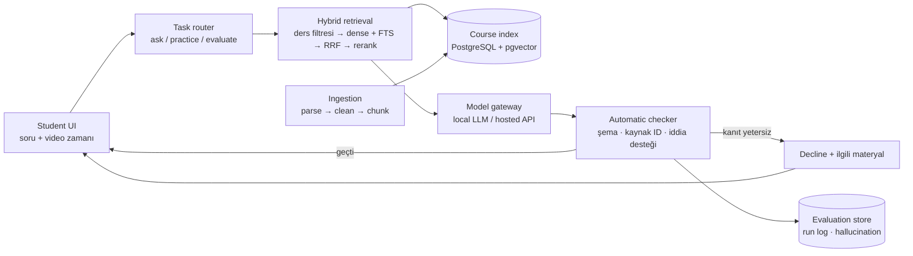

# Interactive Learning Assistant — Proje Analizi

> Kaynak: *Interactive Learning Assistant — Field Research (v4)* sunumu, Engineering Design II · Project 8, Ekim 2026.
> Ekip: Berke Akçay · Emir Ulaş Özdağ · Ceyda Yıldız · Nisanur İlhan · Mehmet Akif Kurt
> Bu doküman sunumdaki kararları **uygulanabilir gereksinimlere, mimari bileşenlere ve bir iş planına** çevirir. Sunumda olmayan her öneri "öneri" veya "açık soru" olarak işaretlenmiştir.

---

## 1. Yönetici özeti

Proje, **tek bir üniversite dersinin onaylı materyaline bağlı kalan** (course-grounded) bir RAG çalışma asistanıdır. Dört temel yetenek tek bir öğrenme döngüsünde birleşir:

| # | Yetenek | Özü |
|---|---|---|
| 1 | **Grounded Q&A** | Yalnızca ders kaynaklarından cevap; sayfa / video-zaman alıntısı; kanıt yoksa **reddet** (cite-or-decline) |
| 2 | **Pratik üretimi** | MCQ · kısa cevap · code tracing; her soru bir kaynak pasaja bağlı ve gösterilmeden önce otomatik kontrol edilir |
| 3 | **Cevap değerlendirme** | Rubrik + referans cevaba göre skor, eksik kavram açıklaması, boşluğa yönelik takip sorusu |
| 4 | **Hallucination kontrolü** | Cevaplar atomik iddialara bölünür, her iddia kaynakla karşılaştırılır, oran **ölçülür ve loglanır** |

**Pilot / MVP:** Veri Yapıları ve Algoritmalar (DSA) dersi, eğitmen ve bölüm üzerinden.
**Uzun vadeli hedef:** Herhangi bir ders. Ders-bağımsız ingestion, her ders için izole bir indeks ve aynı değerlendirme protokolü.

**Özgün katkı yeni özellik eklemek değil.** Var olan parçaları (kaynaklı chat, video-zaman farkındalığı, soru üretimi, RAG'li notlandırma) tek bir ders üzerinde **ölçülebilir bir döngüde birleştirmek** ve otomatik kontrolleri insan yargısına karşı **doğrulamak**.

---

## 2. Problem ve motivasyon

### 2.1 Problem
- Ders bilgisi dağınık: notlar, slaytlar, geçmiş sınavlar, ders videoları.
- Genel chatbotlar akıcı cevap veriyor ama **dersten** cevap vermiyor. Hallucination yapabiliyor, müfredat dışına kayabiliyor, sayfa ya da video anını gösteremiyor.
- Öğrencinin **takıldığı anda** yardıma ve cevabı **derste anlatılanla karşılaştırma** imkânına ihtiyacı var.
- Eğitmenin ihtiyacı ise dersin içinde kalan ve **hata oranı varsayılmayan, ölçülen** bir asistan.

### 2.2 Sahadan kanıtlar (sunum slayt 3)

| Bulgu | Kaynak | Tasarıma etkisi |
|---|---|---|
| Kullanımdaki bir ders-video chatbotuna gelen 833 öğrenci mesajının **%70,5'i** alıntı içeren cevap aldı. **En güçlü karşılanmamış ihtiyaç pratik üretimi + notlandırma** (4,59/5, n=22). | [2] Ahmed & Subhlok, 2026 | Pratik + değerlendirme Iteration 1'in parçası |
| Üç üniversite dersinde öğrencilerin **%65–77,5'i** ders materyali RAG chatbotunu "oldukça" ya da "çok" faydalı buldu. Doğruluk ve güvenilirlik sorunları sürüyor. | [3] Takushima & Kakeshita, 2026 | Güvenilirlik ayrı bir metrik olarak ölçülmeli |
| 4 ders / 118 öğrencilik bir RAG tutor pilotunda cevapların **%16,5'i** ders materyalinde olmayan iddia içeriyordu. Tamamen doğru oranı %70,3. | [4] Németh vd., 2025 | Hallucination hedefi: ≤ %10 (bu referansın altına inmek) |

**Çıkarım:** Öğrenciler kaynaklı cevap ve pratik istiyor, ama güvenilirlik **varsayılamaz, ölçülmelidir**.

---

## 3. Hedef kullanıcılar ve ana senaryo

### 3.1 Paydaşlar

| Rol | İhtiyaç | Sistemle etkileşim |
|---|---|---|
| **Öğrenci** | Takıldığı anda dersten cevap, pratik, geri bildirim | Video oynatıcı + chat, kaynak görüntüleyici, pratik/geri bildirim panelleri |
| **Eğitmen** | Dersin dışına çıkmayan, ölçülmüş bir asistan; sınıfın sık hataları | Materyal onayı, eğitmen görünümü (sık hatalar), cevapları onaylama / düzeltme, rubrik / referans cevap |
| **TA / değerlendirici** | İnsan etiketleme | Pratik soru incelemesi, öğrenci cevabı notlandırma, iddia etiketleri |
| **Bölüm** | Dağıtım kanalı, ders ders yayılma | Pilotun onayı, ikinci derse geçiş |

### 3.2 Ana senaryo: binary search çalışma oturumu (slayt 5)

1. **Durdur ve sor:** Öğrenci videoyu durdurup "Neden sağ yarıyı atabiliyoruz?" diye sorar.
2. **Kaynaklı cevap:** Durdurulan an + ders notları → alıntılı açıklama.
3. **Pratik:** "Bana bir pratik soru ver." → code tracing görevi.
4. **Geri bildirim:** Skor → atlanan adım → takip sorusu.

Bu senaryodaki karar kuralı:
- **Ders kapsıyorsa:** Onaylı kaynaktan cevap ver ve nereden geldiğini göster.
- **Kapsamıyorsa:** Materyalin bunu kapsamadığını söyle. **Cevap uydurma.**

Bu senaryo uçtan uca kabul testinin (Playwright) temelidir: *sor → alıntıyı aç → pratik iste → cevap gönder*.

---

## 4. Kapsam

### 4.1 Iteration 1: Core MVP (pilot ders)
- Notlar, slaytlar, ders kitabı alıntıları, geçmiş sınavlar ve ders transkriptlerinin RAG ile indekslenmesi
- Sayfa / zaman alıntılı grounded Q&A, takip soruları ve reddetme davranışı
- "Bu adım" soruları için **transkript tabanlı** video-pozisyon bağlamı
- Açıklamalı pratik üretimi (MCQ, kısa cevap, code tracing)
- Cevap değerlendirme: rubrik skoru, yapıcı geri bildirim, takip pratiği
- Öğrenme kaydı + eğitmen görünümü (sık hatalar; eğitmen cevapları onaylar ya da düzeltir)
- Hallucination ölçümü, değerlendirme harness'i ve teknik rapor

### 4.2 Sonraki iterasyonlar
| Iteration | İçerik |
|---|---|
| 2 | Durdurulan karenin görsel olarak anlaşılması (VLM: diyagram, kod, formül, slayt metni) + **ikinci dersin** eklenmesi |
| 3 | Konuşma: STT ile sesli soru, TTS ile dinleme. Metin her zaman kalır; tanıma hataları ayrıca ölçülür |
| 4 | İnteraktif materyal: istek üzerine adım adım animasyon (ör. düzenlenebilir dizi üzerinde binary search). Sandbox'ta çalışır, ders kaynağına göre kontrol edilir |

### 4.3 Bilinçli olarak kapsam dışı
- Bir foundation model'i eğitmek veya fine-tune etmek
- **Resmî notlandırma.** Skorlar yalnızca formatif pratik içindir.
- Yayınlanmamış veya aktif sınav içeriği
- Eğitmenin yerini almak veya resmî sınav kâğıdı üretmek
- Üniversite çapında production rollout ve işletim. Tasarım yine de ders-bağımsız kalır.

---

## 5. Fonksiyonel gereksinimler

Her gereksinim, iskeletteki ilgili modüle ve sunumdaki kaynağına eşlenmiştir. Gerçek uygulama durumu ve kabul kanıtı: **§14.1** (FR-01..FR-22 tablosu).

| ID | Gereksinim | Modül | Iter. | Kaynak |
|---|---|---|---|---|
| FR-01 | Ders materyalinin (PDF, PPTX, VTT/altyazı, geçmiş sınav) yüklenmesi ve parse edilmesi | `backend/app/ingestion` | 1 | sl. 11, 14 |
| FR-02 | Temizleme + chunking. Her parça `course_id`, kaynak, **sayfa** ve **başlangıç/bitiş zamanı** metadata'sı taşır | `ingestion` | 1 | sl. 11 |
| FR-03 | Altyazı yoksa faster-whisper ile transkript üretimi | `ingestion` | 1 | sl. 14 |
| FR-04 | **Ders başına izole indeks.** Ders filtresi aramadan **önce** uygulanır | `retrieval`, `db` | 1 | sl. 11, 12 |
| FR-05 | Hibrit arama: multilingual-e5 dense + PostgreSQL FTS, **RRF** ile birleştirme, opsiyonel cross-encoder rerank | `retrieval` | 1 | sl. 12, 14 |
| FR-06 | Video-zaman farkında sıralama: durdurulan zamana yakın pasajlara yumuşak öncelik; tüm ders aranabilir kalır | `retrieval` | 1 | sl. 12 |
| FR-07 | Görev yönlendirme: `ask` / `practice` / `evaluate`, ders filtresi, opsiyonel video penceresi | `routing` | 1 | sl. 11 |
| FR-08 | Model gateway: kural tabanlı local / hosted seçimi. Tüm çıktılar **aynı JSON şemasında** | `llm` | 1 | sl. 11, 14 |
| FR-09 | **Cite-or-decline cevap.** Kaynak ID'li yapılandırılmış çıktı; bilinmeyen ID reddedilir; yetersiz kanıtta reddet ve ilgili materyale yönlendir | `generation`, `verification` | 1 | sl. 12 |
| FR-10 | Konuşma geçmişiyle takip soruları | `generation` | 1 | sl. 16 |
| FR-11 | Tek pasajdan pratik üretimi (MCQ, kısa cevap, code tracing) + açıklama. Kaynak pasaj soruyla birlikte saklanır | `generation` | 1 | sl. 9, 12 |
| FR-12 | Pratik otomatik kontrolleri: anahtar seçeneklerde mi, distraktörler farklı mı, yeniden çözümde aynı cevap çıkıyor mu. **Geçmeyen soru gösterilmez** | `verification` | 1 | sl. 4, 12 |
| FR-13 | Cevap değerlendirme: soruyla birlikte referans cevap + rubrik getirilir → skor, eksik kavramlar, alıntılı açıklama, takip sorusu | `generation` | 1 | sl. 12 |
| FR-14 | Claim-level kontrol: cevap atomik iddialara bölünür; **farklı sağlayıcıdan** bir judge her iddiayı supported / unsupported etiketler; sonuç loglanır | `verification` | 1 | sl. 12 |
| FR-15 | Öğrenme kaydı: öğrenci denemeleri, kavram, hata türü (opt-in, anonim) | `db` | 1 | sl. 10, 16 |
| FR-16 | Eğitmen görünümü: sık hatalar; eğitmen cevapları onaylar ya da düzeltir | `frontend`, `api` | 1 | sl. 16 |
| FR-17 | Ders bazlı erişim kontrolü (öğrenci / eğitmen) | `api` | 1 | sl. 14 |
| FR-18 | Öğrenci arayüzü: video + soru, chat, **sayfa/zamana atlayan** kaynak görüntüleyici, pratik + geri bildirim panelleri | `frontend` | 1 | sl. 11, 14 |
| FR-19 | Değerlendirme harness'i: 4 koşul (no-RAG · basic RAG · full · full + video time), tekrar koşulabilir, run log | `evaluation` | 1 | sl. 13 |
| FR-20 | Durdurulan karenin VLM ile okunması | `ingestion`, `retrieval` | 2 | sl. 17 |
| FR-21 | STT / TTS | `frontend`, `llm` | 3 | sl. 17 |
| FR-22 | Sandbox'ta çalışan, kaynağa göre kontrol edilen interaktif animasyon | `generation`, `frontend` | 4 | sl. 17 |

---

## 6. Fonksiyonel olmayan gereksinimler

| Alan | Gereksinim |
|---|---|
| **Grounding** | Model belleğinden değil, getirilen kanıttan üretim. Alıntı tek başına yeterli sayılmaz, iddia düzeyinde desteklenmelidir. |
| **Ders izolasyonu** | Bir dersin sorgusu başka bir dersin parçasını asla görmez (filtre aramadan önce uygulanır). |
| **Gizlilik / KVKK** | Öğrenci verisi yalnızca **opt-in** onayla, anonimleştirilmiş ve KVKK uyumlu tutulur. **Ders materyali public repoya commit'lenmez**; repoda yalnızca şemalar, scriptler ve anonim değerlendirme verisi bulunur. |
| **Hassas işler local'de** | Hassas veya rutin işler local LLM'de kalır; yalnızca karmaşık ya da düşük güvenli işler hosted API'ye gidebilir. |
| **Dil** | Türkçe ve İngilizce ders metni (multilingual-e5). |
| **Yapılandırılmış çıktı** | Tüm LLM çıktıları Pydantic / JSON şemasıyla doğrulanır. |
| **Tekrarlanabilirlik** | Otomatik değerlendirme her koşuda yeniden çalıştırılabilir; insan etiketleri bir kez toplanır (~200). |
| **Gerileme kapısı** | Yeni bir yetenek yalnızca **temel metrikler gerilemezse** yayınlanır (her iterasyon aynı değerlendirme koşusuyla biter). |
| **Performans** | Locust ile p95 gecikme ölçülür. *Sunumda sayısal bir hedef yok; bkz. §13.* |
| **Kalite süreci** | `main` korumalı; `feature/*` → PR, 1 review + yeşil CI. |
| **Formatif kullanım** | Skorlar resmî not değildir. Arayüz bunu açıkça belirtmelidir. |

---

## 7. Mimari

### 7.1 Bileşenler ve klasör eşlemesi (slayt 11, 18)

| Bileşen (sunum) | Görev | İskelette karşılığı |
|---|---|---|
| Course materials | Notlar · slaytlar · geçmiş sınavlar · transkriptler | `data/` (**gitignore'da**, repoya girmez) |
| Ingestion | Parse → clean → chunk; sayfa + zaman metadata | `backend/app/ingestion/` |
| Course index | PostgreSQL + pgvector + full-text search | `backend/app/db/`, `docker/postgres/init.sql` |
| Student UI | Video zamanı + soru, chat, kaynak görüntüleyici, pratik + geri bildirim | `frontend/` |
| Task router | ask / practice / evaluate; ders filtresi; video penceresi | `backend/app/routing/` |
| Hybrid retrieval | Retrieve → rerank; kaynak ID + pasajlar | `backend/app/retrieval/` |
| Model gateway | Local LLM / hosted API; tek JSON şeması | `backend/app/llm/` |
| Generation | answer · question · grade | `backend/app/generation/` |
| Automatic checker | Şema + kaynak ID; iddia desteği; hallucination log | `backend/app/verification/` |
| Evaluation store | Gold Q&A · rubrikler · insan etiketleri · run log | `evaluation/` |

> Sunumdaki ağaçta `ingestion/`, `retrieval/` gibi klasörler doğrudan `backend/` altında. İskelette bunlar, Python paketi olarak import edilebilsinler diye `backend/app/` altına kondu. Başka bir sapma yok.

### 7.2 İstek akışı (planlanan)

### 7.3 Model yönlendirme ilkesi
- **Başlangıçta kural tabanlı.** Hassas veya rutin işler local'de kalır; karmaşık ya da düşük güvenli işler API'yi kullanabilir.
- **Checker / judge, generator'dan farklı bir model ailesi** kullanır. Böylece modelin kendi hatasını onaylama (self-preference) yanlılığı azalır [16].

---

## 8. Kavramsal veri modeli (öneri)

Sunumda tablo şeması yok. Aşağıdaki tablo, gereksinimlerin ihtiyaç duyduğu **asgari varlıkları** gösterir.
Kodda şu an yalnızca `Course`, `Document`, `Chunk`, `Conversation` ve `Message` (`backend/app/db/models.py`, 3 Alembic migration) vardır;
`User`/`Enrollment`, `PracticeItem`, `Rubric`, `Attempt`, `Claim`/`ClaimCheck`, `InstructorReview` ve `EvalRun` henüz yoktur.
Kimlik, üyelik ve onay alanlarının önerisi: [DECISIONS.md](DECISIONS.md), [CONTRACTS.md §3](CONTRACTS.md).

| Varlık | Temel alanlar | Not |
|---|---|---|
| `Course` | id, kod, ad, dil | İzolasyon birimi |
| `User` / `Enrollment` | id, rol (öğrenci / eğitmen / TA), course_id, opt-in onayı | Erişim kontrolü, KVKK |
| `Document` | id, course_id, tür (not / slayt / kitap / sınav / transkript), başlık, onay durumu | Materyalin kendisi repoda değil, depolamada |
| `Chunk` | id, document_id, course_id, metin, sayfa, t_start, t_end, `embedding vector(768)`, `tsvector` | e5-base = 768 boyut; dense + FTS aynı tabloda |
| `Conversation` / `Message` | id, user_id, course_id, rol, içerik, video_t, alıntılanan chunk_id'ler | Takip soruları |
| `PracticeItem` | id, course_id, tür (MCQ / kısa / code tracing), soru, seçenekler, anahtar, açıklama, **kaynak chunk_id**, kontrol sonuçları, durum | Kontrolden geçmeyen gösterilmez |
| `Rubric` / `ReferenceAnswer` | id, item_id, kriterler, puanlar, eğitmen onayı | Değerlendirme girdisi |
| `Attempt` | id, user_id, item_id, cevap, skor, eksik kavramlar, takip item_id | Öğrenme kaydı |
| `Claim` / `ClaimCheck` | id, message_id, iddia metni, etiket (supported / unsupported), judge modeli | Hallucination oranı |
| `InstructorReview` | id, hedef (message / item), karar (onay / düzeltme), düzeltme | Eğitmen görünümü + moat verisi |
| `EvalRun` | id, commit, koşul, metrik değerleri, tarih | Gerileme kapısı |

---

## 9. Değerlendirme planı (slayt 13)

| Boyut | Otomatik (her koşu) | İnsan (örneklem) | Hedef (hipotez) |
|---|---|---|---|
| Cevap doğruluğu | Judge LLM, **150 test sorusu × 4 koşul**da eğitmen referansıyla karşılaştırır (no RAG · basic RAG · full · full + video time) | 2 değerlendirici, ana koşul başına 40 cevap (0/1/2) | ≥ %80 tamamen doğru |
| Hallucination oranı | Judge her atomik iddiayı getirilen pasajlara göre supported / unsupported etiketler | Aynı 40 cevap, iddia etiketleri → judge–insan uyumu | Desteklenmeyen iddia içeren cevap ≤ %10 |
| Ders-kapsam uyumu | Kural + judge: 30 kapsam dışı soruda reddetme; cevaplanabilir sorularda aşırı reddetme | — | ≥ %90 / ≤ %10 |
| Retrieval kalitesi | Gold kanıt pasajlarına göre Recall@5 | Gold pasajlar soru setiyle birlikte bir kez işaretlenir | ≥ 0,85 |
| Pratik soru kalitesi | Her item'da: anahtar seçeneklerde, farklı distraktörler, yeniden çözüm uyumu | Eğitmen / TA rubrikle 40 item inceler | ≥ %85 kabul edilebilir |
| Cevap-değerlendirme uyumu | Toplanan öğrenci cevaplarında asistan skorları | Eğitmen / TA aynı 60 cevabı notlandırır | QWK ≥ 0,70 |
| Kullanılabilirlik | Loglar: görev süresi, alıntı tıklamaları | SUS + 5'li anket, gönüllü pilot (hedef 20) | SUS ≥ 70; ≥ 4,0 / 5 |

**Tasarım gereği uygulanabilir:** Toplamda yaklaşık 200 insan etiketi gerekiyor; geri kalan her şey otomatik ve yeniden koşulabilir. Judge'a ancak insanla uyumu **κ ≥ 0,6** olursa güvenilir.

**Literatür dayanağı:** RAG [1] · ALCE alıntı recall/precision [8] · RAGAs geliştirme-zamanı regresyon [9] · FActScore atomik iddia [10] · RAGTruth etiketleme şeması [11] · LLM-as-a-Judge yanlılıkları [16].

---

## 10. Teknoloji yığını (slayt 14–15)

| Katman | Teknoloji | Gerekçe |
|---|---|---|
| Diller | Python 3.12, TypeScript, SQL | AI pipeline ekosistemi; tipli web istemcisi |
| Frontend | React + Vite, HTML5 video, Tailwind CSS | Chat, sayfa/zaman atlamalı kaynak görüntüleyici, pratik panelleri |
| Backend | FastAPI, Pydantic, SQLAlchemy | REST, görev yönlendirme, şema-doğrulamalı LLM çıktısı, erişim kontrolü |
| Arama + depolama | PostgreSQL 16 + pgvector, FTS, RRF | Metadata + dense + lexical arama **tek veritabanında** [D1] |
| Embedding / rerank | multilingual-e5 (sentence-transformers), opsiyonel cross-encoder | TR/EN metin; top-k precision [D2] |
| Doküman işleme | PyMuPDF, python-pptx, webvtt-py, faster-whisper | Metin, sayfa ve zaman damgası çıkarımı |
| LLM erişimi | Sağlayıcı-bağımsız adapter, JSON-schema çıktı | Maliyet / kalite için model değiştirilebilir |
| Geliştirme | Git, GitHub, GitHub Actions; Docker Compose | CI her PR'da lint + test |
| Test | pytest + httpx, Playwright, RAGAs + özel iddia harness'i, Locust, Ruff, ESLint, pre-commit | Birim/API, UI akışı, RAG kalitesi, p95 gecikme |
| Proje yönetimi | GitHub Projects: Iterative Development (2 haftalık sprint), Kanban (Backlog → Ready → In progress → Review → Done), Bug Tracker (severity / priority; hallucination vakaları) | [G1] |

---

## 11. Rakip ve boşluk analizi (slayt 7–10)

| Araç | Güçlü yanı | Sınırı (bizim hedefe göre) |
|---|---|---|
| **NotebookLM** | Yüklenen kaynaklardan alıntılı cevap, quiz/flashcard, salt-okunur paylaşım | YouTube'dan yalnızca transkript alınıyor; ekrandaki görseller ve izleme pozisyonu girdi değil; rubriğe göre açık uçlu notlandırma yok; 50 kaynak sınırı (ücretsiz katman) |
| **Khanmigo** | İpucu-önce Sokratik tutoring, ses, kod geri bildirimi | Yalnızca Khan Academy içeriği; özel ders dosyası yok; ABD'de ikamet ve ödeme gerekiyor |
| **DeepTutor** (açık kaynak) | RAG, alıntılı tutoring, zorluk ayarlı soru üretimi, ses | Varsayılan olarak tek kullanıcılı; değerlendirmesi LLM-simüle öğrencilerle yapılmış; gerçek bir derste değerlendirme ve LMS bağlantısı yok. **Yenilik iddiasını sınırlar.** |
| **ChatGPT Projects** | Dosyalar + talimatlarla paylaşılan proje | Kanıtla sınırlı kalmak zorunlu bir kontrol değil, talimat; video bağlamı yok; ölçülmüş hallucination oranı yok |

**Boşluk:** Grounded tutoring + video bağlamı + pratik + cevap değerlendirme + **ölçülmüş güvenilirlik**, tek döngüde ve tek bir gerçek ders üzerinde.

**Katkılar (slayt 9):**
1. Tek döngü, tek kanıt tabanı: sor → pratik → cevap → geri bildirim → takip
2. Kaynağa bağlı ve otomatik kontrol edilen pratik
3. Eğitmen skorlarıyla uyumu raporlanan grounded cevap değerlendirme
4. No-RAG ve basic-RAG baseline'larına karşı ölçülen güvenilirlik; judge insan etiketleriyle doğrulanır

**Kalıcılık (slayt 10):**
- **Giriş noktası:** Tek eğitmenin dersi (DSA).
- **Hendekler** (her pilotla güçlenen hipotezler): ders-özel hata verisi, eğitmenin iş akışı ve geçiş maliyeti, eğitmen/bölüm üzerinden dağıtım, fakülte onaylı güven, kişisel bağlam.

> **Mimariye yansıması:** "Hangi kaynak hangi hatayı düzeltti" kaydı (`Attempt` + `InstructorReview` + kaynak chunk) bir yan ürün değil, **ürünün hendeği**. Veri modeli bunu baştan tutmalı.

---

## 12. Yol haritası ve Iteration 1 iş paketleri

### 12.1 İterasyonlar
Her iterasyon 2 haftalık sprintlerden oluşur ve **aynı değerlendirme koşusuyla** biter. Temel metrikler gerilerse yeni yetenek yayınlanmaz.

| Iteration | Hedef | Çıkış kriteri |
|---|---|---|
| 1 — Core MVP | RAG + grounded Q&A + transkript video bağlamı + pratik + değerlendirme + hallucination ölçümü | §9 metriklerinin ilk tam koşusu ve teknik rapor |
| 2 — Visual + 2. ders | VLM ile kare okuma; aynı pipeline'ın ikinci derse taşınması | 1. ders metrikleri gerilemiyor; 2. derste aynı protokol |
| 3 — Speech | STT / TTS | Tanıma hataları ayrıca ölçülüyor |
| 4 — Interactive | Sandbox'ta kontrol edilen animasyon | Kaynağa göre doğrulama |

### 12.2 Iteration 1 iş paketleri (öneri, GitHub Projects'e girilebilir)

| WP | İş paketi | Bağımlılık | Bitti tanımı |
|---|---|---|---|
| WP0 | **Altyapı iskeleti** (bu repo) | — | ✅ `docker compose up`, `/health`, CI yeşil |
| WP1 | Veri anlaşması ve materyal toplama: eğitmenle onaylı materyal listesi, hangi geçmiş sınavlar kullanılabilir, video/transkript erişimi | — | Onaylı kaynak listesi |
| WP2 | Gold set: 150 test sorusu + referans cevap + gold kanıt pasajları, 30 kapsam dışı soru | WP1 | `evaluation/gold_sets/` şeması dolu (anonim) |
| WP3 | DB şeması + migration (Alembic), pgvector indeksi | WP0 | Migration CI'da çalışıyor |
| WP4 | Ingestion: PDF / PPTX / VTT parse, chunking, metadata | WP1, WP3 | Pilot ders indekslendi; parse birim testleri |
| WP5 | Hybrid retrieval + ders filtresi + video-zaman önceliği | WP4 | Recall@5 ölçülüyor |
| WP6 | Model gateway + JSON şemaları | WP0 | Local ve hosted adapter aynı şemayı döndürüyor |
| WP7 | Cite-or-decline Q&A + takip soruları | WP5, WP6 | Decline ve bilinmeyen ID testleri |
| WP8 | Verification: iddia ayrıştırma + judge + hallucination log | WP6 | Oran her koşuda raporlanıyor |
| WP9 | Pratik üretimi + otomatik kontroller | WP5, WP6 | Kontrolden geçmeyen item gösterilmiyor |
| WP10 | Cevap değerlendirme (rubrik + referans) + takip item | WP9 | QWK hesaplanabiliyor |
| WP11 | Öğrenci arayüzü: video + chat + kaynak görüntüleyici + pratik/geri bildirim | WP7 | Playwright: sor → alıntı aç → pratik → gönder |
| WP12 | Eğitmen görünümü + öğrenme kaydı + erişim kontrolü | WP10, WP11 | Eğitmen onay / düzeltme yapabiliyor |
| WP13 | Evaluation harness: 4 koşul, RAGAs + iddia harness'i, insan etiket sayfaları, κ | WP2, WP8 | Tek komutla yeniden koşulabiliyor |
| WP14 | Pilot (≥ 20 gönüllü, opt-in), SUS + anket, Locust p95, teknik rapor | Hepsi | §9 tablosu dolu |

**Kritik yol:** WP1 → WP2 / WP4 → WP5 → WP7 → WP13. Materyal ve gold set eğitmene bağlı olduğu için **WP1 hemen başlamalı**.

---

## 13. Riskler, tutarsızlıklar ve açık sorular

### 13.1 Riskler

| Risk | Etki | Azaltma |
|---|---|---|
| Video veya transkript erişimi yok, ya da altyazı kalitesi düşük | Video-pozisyon özelliği çalışmaz | faster-whisper; transkript kalitesini ayrıca örnekle |
| Gold set üretimi eğitmen zamanına bağlı (150 soru + referans + rubrik) | Değerlendirme gecikir | Erken başla; TA'larla taslak, eğitmen onayı |
| Judge–insan uyumu κ < 0,6 | Hallucination metriği güvenilmez | Judge modelini veya prompt'u değiştir; insan örneklemini büyüt |
| e5'in 512 token limiti | Uzun chunk'lar kesilir | Chunk boyutunu < 512 token tut; e5'in `query:` / `passage:` öneklerini kullan |
| Türkçe FTS kalitesi | Lexical arama zayıf kalır | PostgreSQL `turkish` text-search konfigürasyonunu `simple` ile karşılaştır |
| Local LLM kalitesi düşük | Daha fazla iş API'ye kayar → maliyet ve gizlilik riski | Yönlendirme kurallarını loglarla ayarla; maliyeti izle |
| KVKK: QWK için 60 öğrenci cevabı ve pilot logları | Yasal / etik risk | Opt-in onay formu, anonimleştirme, etik kurul / bölüm onayı |
| Geçmiş sınav ile "aktif sınav içeriği" ayrımı | Kapsam ihlali | Eğitmen onaylı liste (WP1) |
| DeepTutor ile özellik örtüşmesi | Yenilik iddiası zayıflar | Katkıyı "gerçek derste ölçülmüş döngü" olarak konumla (zaten öyle) |

### 13.2 Sunumdaki tutarsızlıklar
1. **Repo adı.** Sunumda `github.com/emirulasozdag/Learning-Asistent`, git remote'unda ise `emirulasozdag/Learning-Asistant` yazıyor. Hangisinin doğru olduğu netleştirilmeli; sunum, README ve remote aynı olmalı.
2. **Materyal listesi.** Resmî proje tanımı (Project 08) ders kitaplarını açıkça kapsıyor ve slayt 16 da buna uyuyor. Ancak mimari slaytındaki (11) "Course materials" kutusunda kitap yok; diyagram güncellenmeli. Telif açısından hangi kitap bölümlerinin indekslenebileceği eğitmenle netleşmeli.
3. **İnsan etiketi sayısı.** "Ana koşul başına 40 cevap" deniyor ama kaç ana koşul olduğu belirtilmemiş. Tek koşulla toplam 40 cevap + 40 pratik item + 60 öğrenci cevabı = 140 eder. ~200 toplamına neyin dahil olduğu (ikinci bir koşul mu, gold pasaj işaretlemesi mi) netleştirilmeli.
4. **Performans hedefi yok.** Locust p95 ölçülecek, ama hedef değer belirtilmemiş.

### 13.3 Açık sorular (ekip kararı gerekli)
- Hangi local LLM ve hangi hosted sağlayıcı? Judge hangi model ailesinden olacak?
- Videolar nerede barındırılıyor (LMS, YouTube, dosya)? Oynatıcıya nasıl gelecek?
- Kimlik doğrulama: üniversite SSO mu, basit hesap mı?
- Pilot takvimi: hangi hafta / hangi konu (ör. binary search) ile başlanacak?
- Ders materyali nerede saklanacak (repo dışı; yerel disk mi, nesne depolama mı)?

---

## 14. Uygulamanın durumu

> Son uzlaştırma: 2026-10-20 (issue #6, aşama 2; PR #68 sonrası), gerçek kodla karşılaştırılarak. Bu bölüm, önceki "iskelet" durumunun yerini alır.

| Parça | Durum |
|---|---|
| Klasör yapısı (slayt 18) | ✅ |
| `docker compose up`: PostgreSQL 16 + pgvector, FastAPI, Vite | ✅ |
| `GET /health` + test | ✅ |
| Frontend: tasarım sistemi, giriş/kayıt (sahte), ders sayfası, AI Tutor, Materyaller, Etkinlik | ✅ Eğitmen: Genel bakış, Materyaller, Etkinlik; öğrenci: Genel bakış, Materyaller, AI Tutor. Hepsi gerçek API. Giriş/kayıt **sahte** (localStorage, FR-17); tek kalan mock budur. Pratik arayüzü yok (silindi) |
| CI: ruff + pytest (PostgreSQL ile), eslint + build | ✅ Playwright testleri CI'da **çalışmıyor** (bkz. CONTRACTS.md §6.6) |
| Issue şablonları (Bug, hallucination alanlarıyla birlikte; Görev) + PR şablonu | ✅ |
| DB: `courses` (ders bilgisi alanlarıyla), `documents`, `chunks`, `conversations`, `messages` + 3 Alembic migration | ✅ Diğer varlıklar (§8) yok |
| Çalışan özellik mantığı | ✅ Yükleme hattı (PDF/PPTX), hibrit arama, cite-or-decline cevap + alıntı doğrulama, kaynak görüntüleyici, ders yönetimi ve ders bilgisi düzenleme (`PATCH /courses/{id}`), eğitmen soru-cevap etkinliği (`GET /instructor/courses/{id}/activity`) |
| Henüz iskelet (`501` / `NotImplementedError`) | Pratik, değerlendirme, öğrenme kaydı, sık hatalar ve eğitmen onay/düzeltmesi, rubrik; kimlik/yetki; video/transkript; claim kontrolü; rerank; task router; local LLM; eval harness |
| Playwright UI testleri | ✅ `frontend/e2e/` (#7): AI Tutor ve hata durumları. *Sor → alıntı → pratik → gönder* akışı pratik gelince eklenecek |
| RAGAs / Locust | ⏳ WP13 / WP14 |

### 14.1 Fonksiyonel gereksinim → gerçek durum → kabul kanıtı

Durum: ✅ tamam · 🟡 kısmen · ⬜ yok (iskelet / yazılmadı). "Önceki" sütunu, bu güncellemeden önceki dokümandaki durumdur;
farklıysa gerekçesi dosya sütunundadır.

| FR | Durum (önceki) | Gerçek dosyalar | Önerilen kabul kanıtı |
|---|---|---|---|
| 01 Yükleme / parse | 🟡 (✅ PDF/PPTX · ⬜ VTT) | `ingestion/parsers/{pdf,pptx}_parser.py`, `ingestion/pipeline.py`, `api/materials.py`; FE: `features/materials/*`, `pages/instructor/MaterialsPage.tsx`. VTT: `vtt_parser.py` iskelet (sözleşme koda geçti: `Document.duration_s/media_url`, #14 PR a; davranış sonraki PR'larda). `past_exam` yalnızca bir etiket | Mevcut: `test_flow` (upload pdf/pptx/reddetme), `test_ingestion`. Eklenecek: VTT fixture ile parse testi |
| 02 Temizleme + chunking + metadata | 🟡 (önceki ✅) | `ingestion/{cleaning,chunking,pipeline}.py`, `embeddings/`. **Sayfa** metadata'sı tam; `Chunk.t_start/t_end` sütunları var ama hiçbir yol doldurmuyor. *Sözleşme koda geçti (#14 PR a: `IngestionReport` video alanları, `RetrievalHit.t_start/t_end`); davranış #14'ün sonraki PR'larında* | Mevcut: `test_ingestion` (chunk/temizleme), `test_upload_returns_pipeline_report…`. Eklenecek: VTT chunk'larında `t_start/t_end` testi |
| 03 Transkript (whisper) | ⬜ | `ingestion/transcribe.py` iskelet (sözleşme koda geçti, #14 PR a; davranış sonraki PR'larda) | Kısa ses fixture'ı ile zaman damgalı segment testi; örneklemde WER ölçümü |
| 04 Ders izolasyonu | 🟡 (önceki ✅) | Arama ve sohbet izole: `retrieval/{dense,lexical}.py` (`course_id` filtresi), `qa/service.py`. **Güvenlik açığı — #11'de kapatılmalı:** `GET /sources/{id}`, `/documents/{id}/{chunks,file,pages}` ve `DELETE /documents/{id}` (`api/sources.py`, `api/materials.py`) dersle ve kullanıcıyla sınırlı değil | Mevcut: `test_search_is_isolated_per_course`, `test_conversation_is_remembered_and_isolated`. Eklenecek (#11): üye olmayan kullanıcı başka dersin `source_id`/doküman uç noktasında 404 alır |
| 05 Hibrit arama + RRF + rerank | 🟡 (✅ rerank hariç) | `retrieval/{dense,lexical,fusion,hybrid}.py`; `rerank.py` iskelet | Mevcut: `test_retrieval` (RRF, ağırlıklar). Ölçüm: gold set üzerinde Recall@5 ≥ 0,85 (harness yok) |
| 06 Video-zaman önceliği | ⬜ | `retrieval/video_time.py` iskelet. `AskRequest.video` (`VideoRef`, #14 PR a ile `video_time_s`'in yerine) kabul ediliyor, `retrieve(video=…)` yok sayıyor, frontend göndermiyor; öncelik #14'ün sonraki PR'larında. Video oynatıcı yok | Prior için birim testi; eval'de "full + video time" ile "full" karşılaştırması. Sözleşme: CONTRACTS.md §4 |
| 07 Task router | ⬜ | `routing/router.py` iskelet; görev başına ayrı endpoint var | Ekip kararı (DECISIONS.md açık soru 4): ayrı endpoint'ler yeterli sayılırsa bu satır ✅; değilse router birim testi |
| 08 Model gateway | 🟡 | `llm/{base,openrouter,hosted,gateway}.py` (env tabanlı seçim); `llm/local.py`, `select_judge_client` iskelet | Sahte iki adapter ile aynı şemanın döndüğünü gösteren test; kural tabanlı seçim testi |
| 09 Cite-or-decline | ✅ | `generation/answer.py`, `verification/citations.py`, `qa/service.py`, `api/ask.py` (`/ask`, `/ask/stream`); `AskResponse.outcome` (#5). FE: `pages/student/TutorPage.tsx`, `features/tutor/*` | Mevcut: `test_answer.py` (~24), `test_flow` akış testleri; `frontend/e2e/*`. Ölçüm: 30 kapsam dışı soruda ≥ %90 ret, aşırı ret ≤ %10. Açık: sonuç/hata sözleşmesi eksikleri (CONTRACTS.md §5) |
| 10 Takip soruları | 🟡 (önceki ✅) | `qa/service.py` (son 3 tur). Sohbet bir kullanıcıya bağlı değil — #11 | Mevcut: `test_follow_up_question_gets_history`. Eklenecek (#11): başka kullanıcının `conversation_id`'si 404 |
| 11 Pratik üretimi | ⬜ | `generation/question.py` iskelet; `api/practice.py` 501; FE: yok (`PracticePage` PR #68'de silindi; `/student/practice` → `/student`). Tipler: `schemas/practice.py`, `types.ts` | `POST /practice`: `source.source_id` bir chunk'a çözülür. Sözleşme: CONTRACTS.md §2 |
| 12 Pratik kontrolleri | ⬜ | `verification/practice_checks.py` iskelet | Kontrolden geçmeyen item'ın dönmediğini gösteren test; eğitmen/TA 40 item'da ≥ %85 kabul |
| 13 Cevap değerlendirme | ⬜ | `generation/grade.py` iskelet; `api/practice.py` 501 | `POST /practice/{id}/answer` testi; 60 cevapta QWK ≥ 0,70 |
| 13 Rubrik + referans cevap girişi | ⬜ | `instructor/rubrics.py` iskelet; `api/rubrics.py` 501 | Rubrik oluşturma/listeleme API testi; eğitmen onayı (`approved`) |
| 14 Claim kontrolü + hallucination log | ⬜ | `verification/{claims,judge,hallucination}.py` iskelet. (Cümle düzeyinde etiket doğrulaması FR-09'dadır; judge değildir) | Gold set üzerinde unsupported oranı ≤ %10; judge–insan κ ≥ 0,6 |
| 15 Öğrenme kaydı | ⬜ | `learning/record.py` iskelet; `api/learning.py` 501. `messages.meta` yalnızca ret/alıntı bilgisi tutuyor; kullanıcı bağı yok | `research_logging` kapalıyken kayıt yazılmadığını gösteren test (ADR-4) |
| 16 Eğitmen görünümü | 🟡 (önceki ⬜; PR #68 ile) | **Gerçek:** soru-cevap etkinliği: `instructor/activity.py`, `GET /instructor/courses/{id}/activity` (anonim, ders düzeyinde: sayılar, son 14 gün, en çok alıntılanan kaynaklar, materyalde cevabı bulunamayan sorular); FE: `pages/instructor/CourseActivityPage.tsx`, `services/instructorService.ts`. **İskelet:** `instructor/{mistakes,review}.py` (sık hatalar, onay/düzeltme); `api/instructor.py` bu iki uç nokta için 501. *Not:* etkinlik soru-cevap analitiğidir, "sık hata" (FR-16 kabulü) değil; doküman listesi/parça önizleme/yükleme raporu FR-01/02'nin eğitmen arayüzüdür (`MaterialsPage`) | Mevcut: `test_instructor_activity_is_computed_from_real_questions`, `test_instructor_activity_for_unknown_course_is_404`. Eklenecek: onay/düzeltme API testi; Playwright: eğitmen bir cevabı düzeltir. Etkinlik ekranının onay kapsamı: DECISIONS.md açık soru 9 |
| 17 Erişim kontrolü | ⬜ | `auth/dependencies.py` iskelet; hiçbir endpoint kimlik doğrulamıyor (PR #68'in `PATCH /courses/{id}` ve `GET /instructor/courses/{id}/activity` uç noktaları dahil). Tipler: `schemas/common.py` (`Role`), `schemas/auth.py`, `types.ts` (kullanan endpoint yok). FE: `services/authService.ts` **sahte** (localStorage), `auth/RequireRole.tsx` yalnızca istemci tarafında | Rol matrisi testi (endpoint × rol × üyelik → 200/401/403/404); #11 ve #12. Kararlar: DECISIONS.md ADR-1, 2 |
| 18 Öğrenci arayüzü | 🟡 | AI Tutor: `pages/student/TutorPage.tsx`, `features/tutor/{AnswerBlock,SourceCards,SourcePanel,SourceViewer,RetrievalDetails,outcome}.ts*`; ders sayfası: `layouts/CourseShell.tsx`, `pages/course/CourseOverview.tsx`, `pages/student/CourseMaterialsPage.tsx`. Kaynak görüntüleyici: `sources/lookup.py`, `ingestion/rendering.py`, `GET /sources/{id}`. Video ve pratik/geri bildirim panelleri yok | Mevcut: `frontend/e2e/{tutor,failures}.spec.ts` (CI'da çalışmıyor). Eksik: *sor → alıntıyı aç → pratik iste → cevap gönder* uçtan uca senaryosu |
| Ders yönetimi | ✅ | `courses/service.py`, `api/courses.py` (`GET/POST /courses`, `PATCH /courses/{id}`); ders bilgisi alanları `instructor_name, term, level, department, description` (`db/models.py`, migration `b7d21c9e4a10`); FE: `features/courses/*` (`CourseInfoDialog`, `CreateCourseDialog`). Yetki yok (FR-17) | Mevcut: `test_courses_are_listed`, `test_create_course_normalizes_code_and_rejects_duplicates`, `test_course_info_is_created_updated_and_listed`, `test_updating_unknown_course_is_404` |
| 19 Değerlendirme harness'i | ⬜ | `evaluation/harness/{run,conditions,judge_agreement}.py`, `metrics/*` iskelet (`NotImplementedError`); `gold_sets/` boş | Tek komutla 4 koşulun koşulması ve run log |
| 20–22 (Iteration 2–4) | ⬜ bilinçli | — | Iteration 1'de kabul kanıtı yok; kapsam dışı |

**Dokümanda kalan çelişkiler (düzeltildi):** §14.1'deki eski frontend yolları (`features/qa/ChatPanel`,
`pages/StudentPage`, `features/sources/SourceViewer`, `features/video/VideoPlayer`, …) artık yok; yukarıdaki dosyalar gerçektir.

**Açık güvenlik maddesi:** FR-04 satırındaki kaynak/doküman endpoint'leri; kimliksiz yükleme/silme/ders oluşturma;
kimliksiz `PATCH /courses/{id}` (herkes herhangi bir dersin bilgisini değiştirebilir) ve `GET /instructor/courses/{id}/activity`
(herkes herhangi bir dersin öğrenci soru metinlerini görebilir) — **#11'de kapatılmalı** (DECISIONS.md açık soru 5).

API sözleşmeleri `backend/app/schemas/` altında; frontend'deki karşılıkları `frontend/src/api/types.ts`.
Önerilen değişiklikler ve ortak dosya protokolü: [CONTRACTS.md](CONTRACTS.md). Ekip kararları: [DECISIONS.md](DECISIONS.md).

---

## Kaynaklar

Tam açıklamalı liste sunumun 19–23. slaytlarındadır: [1] Lewis 2020 · [2] Ahmed & Subhlok 2026 · [3] Takushima & Kakeshita 2026 · [4] Németh 2025 · [5] ALIVE · [6] LECTRA · [7] Intra-Video Temporal RAG · [8] ALCE · [9] RAGAs · [10] FActScore · [11] RAGTruth · [12] Olney 2023 · [13] Mucciaccia 2025 · [14] Chu 2025 · [15] TheoremExplainAgent · [16] LLM-as-a-Judge · [T1] NotebookLM · [T2] Khanmigo · [T3] DeepTutor · [T4] ChatGPT Projects · [D1] pgvector · [D2] multilingual-e5 · [G1] GitHub Projects.
